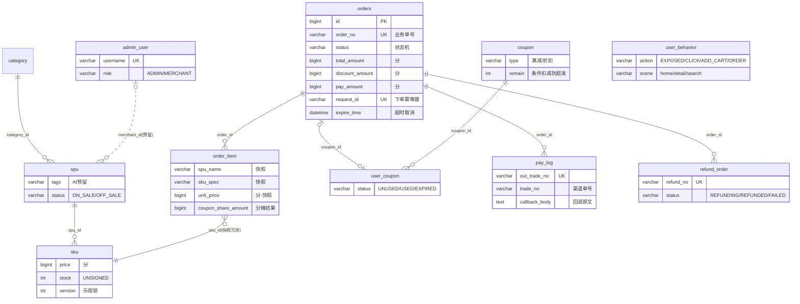

# 数据库设计（M1 版）

> 唯一建表源：`docker/init/schema.sql`（dev 全量 DDL，重复应用 = 重置数据）。
> 本文只讲"为什么这么设计"，逐字段注释见 schema.sql。

## 1. 表清单（9 张核心 + 2 张 M1 配套）

| 表 | 职责 | 里程碑 |
|---|---|---|
| `orders` | 订单主表，状态机 + 金额三分 + 幂等键 | M1 建 / M2 用 |
| `order_item` | 订单明细，商品信息**下单时快照** + 优惠分摊结果 | M1 建 / M2 用 |
| `pay_log` | 支付流水，回调幂等锚点 | M1 建 / M4 用 |
| `refund_order` | 退款单，退款回调幂等锚点 | M1 建 / M4 用 |
| `spu` | 商品 SPU，`tags` 为 AI 推荐预留 | M1 |
| `sku` | 商品 SKU，库存扣减与乐观锁落点 | M1 |
| `coupon` | 优惠券模板，余量条件扣减防超发 | M1 建 / M3 用 |
| `user_coupon` | 用户持券，领券幂等 + 核销 CAS | M1 建 / M3 用 |
| `user_behavior` | 行为埋点（AI 预留地基），append-only | M1 建 / M5 写入 |
| `category` | 商品分类（M1 分类管理需要） | M1 |
| `admin_user` | 管理端账号，RBAC 用 role 区分 | M1 |

## 2. ER 图

## 3. 幂等唯一索引 ↔ 接口映射（计划书 §4.11）

| 接口 | 幂等手段 | 落在表上的索引 |
|---|---|---|
| 下单 | 请求令牌 + 唯一索引兜底 | `orders.uk_request_id` |
| 支付回调 | 双单号唯一 + 状态 CAS | `pay_log.uk_out_trade_no` + `uk_out_trade_trade` |
| 退款回调 | 退款单号唯一 + 状态 CAS | `refund_order.uk_refund_no` |
| 领取优惠券 | 持券唯一 + 余量条件扣减 | `user_coupon.uk_user_coupon` |
| MQ 消费去重 | 业务键唯一或 Redis 去重表 | M5 按消费场景落 |

> `pay_log` 为什么两个唯一索引：`uk_out_trade_no` 挡"同一商户单号重复发起"，
> `uk_out_trade_trade(out_trade_no, trade_no)` 挡"渠道侧重试通知重复落库"——
> `trade_no` 回调前为 NULL，MySQL 唯一索引对 NULL 放行，不冲突。

## 4. 设计决策

1. **雪花 ID 不用 AUTO_INCREMENT**：ID 由应用层（MyBatis-Plus `ASSIGN_ID`）生成。
   理由：多写入点/MQ 异步落库时 ID 全局唯一；批量插入前就能拿到 ID 建关联；
   也是"预留分库分表"叙事的地基（虽不上分库分表，ID 方案先对齐）。
2. **金额一律 BIGINT 分**：杜绝浮点误差；`pay_amount = total_amount - discount_amount`
   由应用保证，DB 不设生成列（保留分摊算法的自由度，§4.8）。
3. **状态字符串枚举**：`PENDING_PAY/PAID/MAKING/READY/COMPLETED/CLOSED/REFUNDING/REFUNDED`。
   可读性好于 TINYINT，排查问题看一眼就懂；流转合法性由应用层状态机映射表把关，
   DB 层 `UPDATE ... WHERE status=旧值` 的 CAS 做最后一道防线（§4.2）。
4. **快照字段**：`order_item.spu_name/sku_spec/sku_image/unit_price` 下单时固化，
   商品改价改名不影响历史订单与退款计算。
5. **库存与余量**：`sku.stock` / `coupon.remain` 用 `INT UNSIGNED` 做 DB 层兜底
   （减成负数直接报错），配合应用层条件更新 `WHERE stock >= ?` / `WHERE remain > 0`。
6. **逻辑删除只给可删数据**（`spu/sku/category.deleted`）：订单、支付、流水、埋点
   只增不删——审计与对账要求；`admin_user` 用 `status=0` 禁用代替删除。
7. **AI 预留三件套**：`spu.tags`（结构化标签）、`user_behavior`（埋点表，
   索引按 `idx(user_id, action)` / `idx(item_id, action)` 设计好推荐查询路径）、
   `spu.merchant_id`（多商家隔离预留，M1 先置 NULL 不启用）。
8. **user_behavior 无 updated_at**：append-only，只写不更不删；
   采集链路异步批量写（§4.12），丢几条没关系，阻塞交易不行。
9. **每用户限领 1 张**：`uk(user_id, coupon_id)` 先锁死 1 张/人，`per_user_limit`
   字段留着；将来放宽为限领 N 张时改唯一键为 `(user_id, coupon_id, batch_no)`。
10. **字符集**：utf8mb4 / `utf8mb4_unicode_ci`，与 docker-compose 的 MySQL 启动参数
    一致；时区统一 Asia/Shanghai（+08:00）。

## 5. 开发环境连接（2026-11-08 现状）

| 项 | 值 |
|---|---|
| 实际生效库 | **Windows 本地 MySQL80 服务**（8.0.45，`localhost:3306`，root/root123） |
| docker meal-mysql | 仍运行但 3306 被本地实例遮蔽，密码仍为 meal_root_2026；仅作 compose 完整性保留 |
| 建库方式 | 本地：`mysql -uroot -p < docker/init/schema.sql`（文件内含 CREATE DATABASE） |
| docker 侧 | 数据卷首次初始化时由 `/docker-entrypoint-initdb.d/` 自动执行同一文件 |
